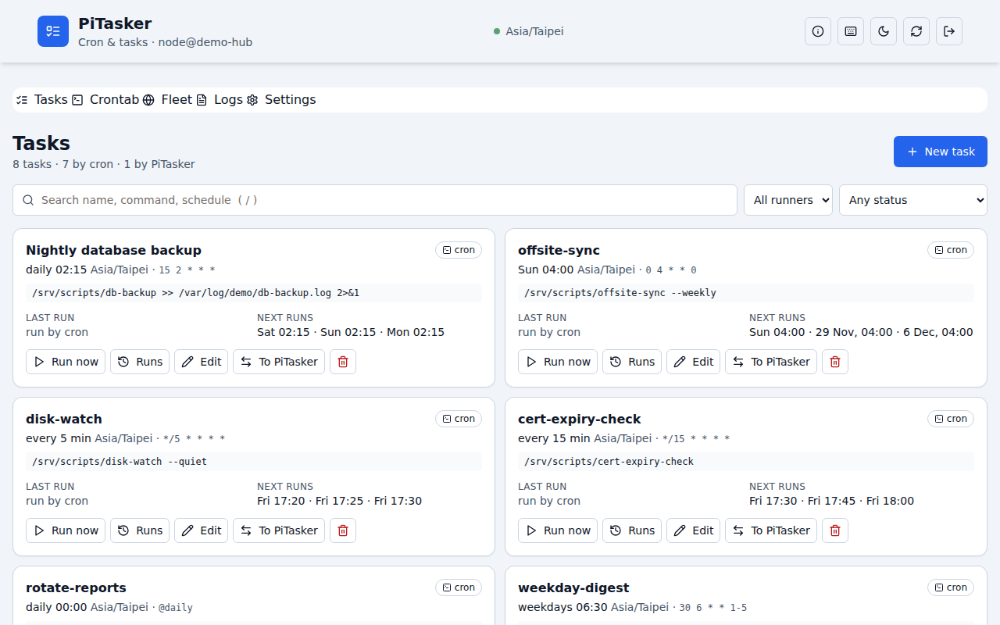
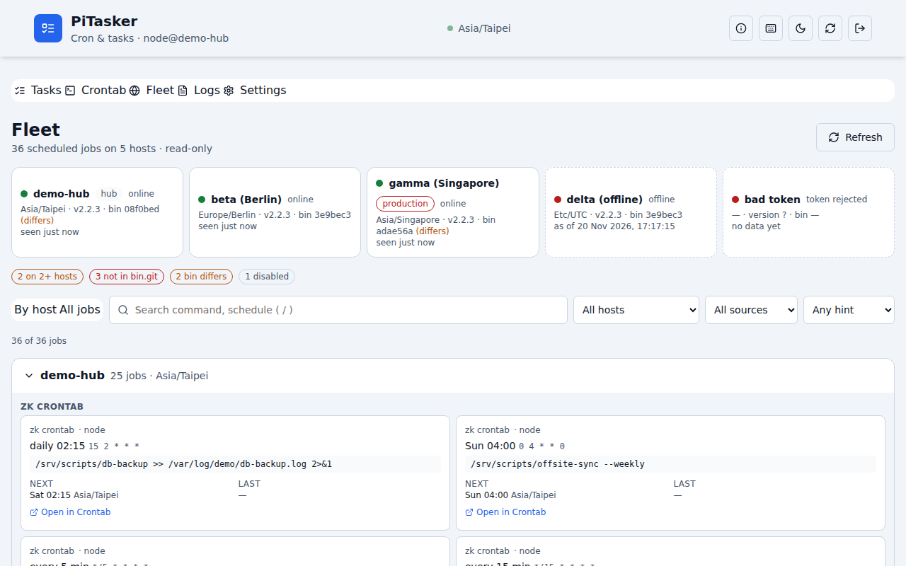
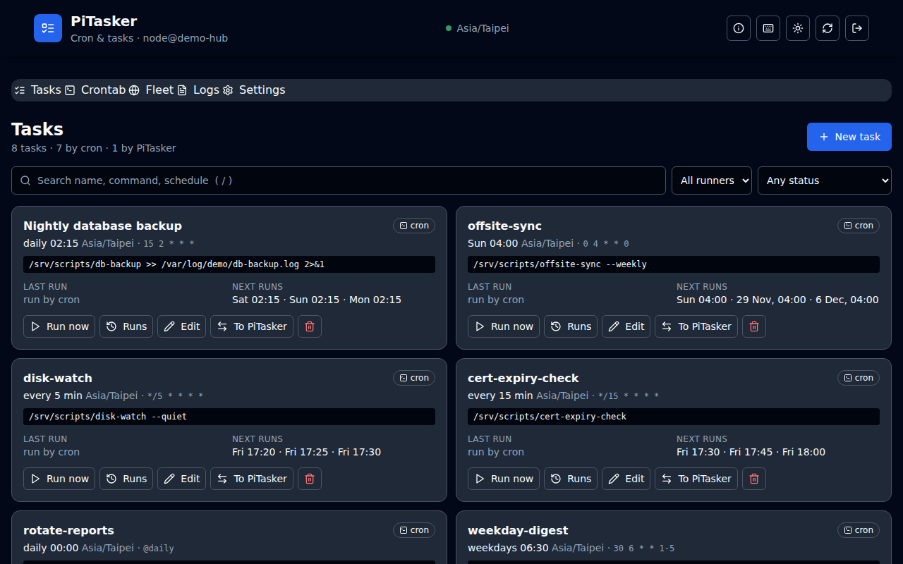

# PiTasker

[](https://github.com/hexawulf/PiTasker/actions/workflows/ci.yml)
[](https://github.com/hexawulf/PiTasker/releases/latest)
[](LICENSE)
[](.nvmrc)

A web UI for the crontab on a small Linux server (built for a Raspberry Pi,
runs on any Linux host). See, edit and run the jobs in a user's crontab,
let PiTasker run the jobs that should not live in cron, and see — read-only —
everything that is scheduled on the other hosts of a small fleet.



## Features

- **One runner per task.** A task runs from the **crontab** (PiTasker keeps
  its line in sync) **or** from **PiTasker's scheduler**, never both. Moving
  a task between runners edits the crontab and (un)schedules it in one step.
- **Your crontab stays yours.** Comments, section headers, env lines
  (`MAILTO=`, `PATH=`, `TZ=`), blank lines, `@reboot`/`@daily`, `\%` escapes
  and commented-out lines are kept byte-for-byte. Import never writes the
  crontab; an export with no change writes nothing. PiTasker only adds its own
  `# PITASKER_ID:` / `# PITASKER_COMMENT:` markers above the lines it writes.
- **A diff before every write.** The write is sent with the hash of what you
  saw and is refused if the crontab changed meanwhile. The old crontab is
  backed up first (newest 50 kept, restorable from the UI) and the new one is
  read back after; on a mismatch the old one is restored.
- **Run history** for every run PiTasker starts (scheduled or *Run now*):
  exit code, duration, stdout and stderr (tail kept). A timeout kills the
  whole process group. For cron-run jobs, the last start comes from the job's
  log file or the cron journal.
- **Readable schedules**: "every 5 min", "weekdays 06:30", the next three
  runs in the host's time zone, and an editor with presets, per-field inputs,
  live validation and a warning when a script is outside the bin directory or
  not committed to its git repository.
- **Fleet view (read-only).** One page for every crontab, `/etc/crontab`,
  `/etc/cron.d/*`, `cron.{hourly,daily,weekly,monthly}` and systemd timer
  on every host, in each host's own time zone, with hints: *same job on two
  hosts*, *script not in bin.git*, *bin replica differs*, *disabled*.
- **Sign-in**: Google (Firebase Auth) limited to an email allowlist, with a
  local username/password kept as the break-glass fallback.
- **UI**: light and dark themes, works at 390 px, keyboard shortcuts
  (`?` lists them), axe-checked pages, and an About dialog with a one-line
  diagnostics string for bug reports.



<details>
<summary>Dark theme</summary>



</details>

## How it works

```
browser ──► nginx (TLS) ──► PiTasker hub (Express, pm2)
                              │  session auth · CSRF guard · CSP
                              ├─ crontab ◄── server/crontab: parse → edit → diff
                              │               → backup → `crontab -` → read back
                              ├─ scheduler + runner (PiTasker-run tasks, run history)
                              ├─ PostgreSQL (tasks, runs, sessions)
                              └─ fleet hub ──► PiTasker agent on each host
                                               GET only · bearer token · LAN/tunnel
                                               address · redacts secrets first
```

- The **hub** is one Node process: the React SPA, the API, the scheduler and
  the fleet hub. It reads its own host in-process.
- An **agent** is one bundled file (`dist/agent.mjs`, Node built-ins only)
  with two routes: `GET /api/agent/health` and `GET /api/agent/cron`. It runs
  as an unprivileged user without sudo; root's crontab comes from a root-owned
  snapshot unit. Design notes: [docs/plans/2.1-fleet-view.md](docs/plans/2.1-fleet-view.md).

## Quick start

Needs Node 22+, PostgreSQL and a user crontab (`crontab -l` works).

```bash
npm ci
cp .env.example .env        # PORT, DATABASE_URL, SESSION_SECRET (openssl rand -hex 32), …
npm run db:migrate          # creates or upgrades the schema
npm run db:seed             # first install only: creates "admin" (random password printed once,
                            # or PITASKER_ADMIN_PASSWORD)
npm run build
pm2 start ecosystem.config.cjs && pm2 save
```

The server refuses to start while migrations are pending.

## Configuration

Every setting is in [.env.example](.env.example), with its default. The main ones:

| Variable | Purpose |
|---|---|
| `PORT`, `HOST` | Where the hub listens (default host `0.0.0.0`; `127.0.0.1` behind a local nginx) |
| `DATABASE_URL`, `SESSION_SECRET` | PostgreSQL and the session secret (32+ characters) |
| `PITASKER_ORIGIN` | The public origin; state-changing requests from another origin are refused |
| `CSP_ENFORCE` | `true` enforces the CSP (otherwise Report-Only, logged as `[csp]` lines) |
| `PITASKER_TZ` | Time zone for PiTasker's own schedules (default: the host's) |
| `PITASKER_BIN_DIR` | Where cron-invoked scripts should live (the editor warns otherwise) |
| `PITASKER_CRON_JOURNAL` | `on`: read the cron journal for the last start of cron-run jobs |
| `FIREBASE_*` | Google sign-in: `FIREBASE_ENABLED`, the service account path, `FIREBASE_ALLOWED_EMAILS` and the public client keys |
| `PITASKER_HOSTS`, `PITASKER_HOST_TOKEN_<ID>` | Fleet agents (`id=http://ip:5017,…`) and one token each |

## Fleet agents

1. `npm run build:agent` on the hub.
2. Copy `dist/agent.mjs`, `scripts/install-agent.sh` and `deploy/` to the host
   (the installer renders the systemd units from `../deploy/`).
3. `scripts/install-agent.sh --dry-run --bind <lan-or-tunnel-ip> --ufw-allow-from <hub-ip> --bundle ~/agent.mjs`,
   then without `--dry-run`. See `--help` for `--update`, `--rollback`,
   `--uninstall` and `--root-snapshot-only` (for the hub).
4. Move the printed token to the hub's `.env` as `PITASKER_HOST_TOKEN_<ID>`
   and add the host to `PITASKER_HOSTS`.

## Development and tests

```bash
npm run dev                 # tsx server/index.ts
npm run check               # tsc
npm run lint                # eslint (recommended rule sets)
npm run check:theme         # UI colours only from the --pi-* tokens
npm test                    # vitest; DB suites need PITASKER_TEST_PG_URL (admin URL, creates pitasker_test_*)
npm run test:e2e            # Playwright against a scratch build on :5027 + fixture fleet agents
npm run test:install        # the agent installer, with stubs (no root, no real /etc)
npm run check:shell         # shellcheck
npm run screenshots         # the README screenshots, from the E2E harness and demo data
```

Tests never touch the real crontab, database or system: a fake `crontab` is
first on `PATH` (the crontab code refuses to run under vitest/E2E without
it), `server/db.ts` accepts only `pitasker_test_*` / `pitasker_e2e*`
databases in a test run, and the fleet collector refuses the real
`systemctl`, `journalctl`, `timedatectl` and `/etc` in tests (fakes from
`tests/fakes/`, fixture hosts from `tests/fixtures/fleet/`). CI runs all of
the above on every pull request.

## Deployment

PiTasker runs under pm2 (`ecosystem.config.cjs`, settings in `.env`) behind
a reverse proxy that terminates TLS (Express trusts one proxy hop). To
update: pull, `npm ci`, `npm run db:migrate`, `npm run build`,
`pm2 restart pitasker`. Release notes, and upgrade steps where a release
needs them, are in the [Changelog](CHANGELOG.md).

## Security

- Login on every `/api` route except the login endpoints and the public auth
  config; a test walks the router to enforce it.
- Session cookie `pitasker.sid`: Secure, HttpOnly, SameSite=Lax, a new
  session id at login. State-changing requests must be same-origin JSON.
- Login and password changes are rate-limited (10 per 10 min per client).
- Helmet headers and a CSP with hashes of the inline scripts; Firebase hosts
  only when Google sign-in is on.
- Passwords: at least 12 characters, not the username; a change logs out the
  other sessions.
- Fleet agents: GET only, a bearer token stored as SHA-256, secrets redacted
  on the agent, no sudo (empty capability bounding set).

To report a vulnerability, see [SECURITY.md](SECURITY.md).

## Project layout

```
client/src/        React SPA (pages: tasks, crontab, fleet, logs, settings)
server/app.ts      Express app factory (routes, session, CSRF guard, CSP)
server/routes/     API routes; http.ts holds the shared handler helpers
server/crontab/    document.ts (line-preserving parser/editor), store.ts (crontab IO,
                   backups, read-back), sync.ts (tasks ⇄ crontab), cache.ts
server/services/   exec.ts, taskRunner.ts, taskScheduler.ts, cronSeen.ts, scriptCheck.ts,
                   firebase-auth.ts
server/fleet/      collector.ts (one host's snapshot), hub.ts (agents, saved snapshots),
                   hints.ts, redact.ts, tools.ts (execFile, test guards)
server/agent/      the agent → dist/agent.mjs; deploy/ holds its systemd units
shared/            cron.ts (validation, descriptions, next runs), schema.ts (tables),
                   fleet.ts (snapshot schema)
migrations/        drizzle SQL; scripts/migrate*.mjs apply them
tests/             unit/ (vitest), e2e/ (Playwright), install/, fakes/, fixtures/
docs/plans/        the 2.0 plan and the 2.1 fleet-view design record
```

## Roadmap

- **Fleet editing**: edit a user crontab on other hosts through the agent
  (separate write token, diff + backup + audit for every write). Root
  crontabs and `/etc/cron.d` stay read-only until a later opt-in.

## License

MIT — see [LICENSE](LICENSE).
